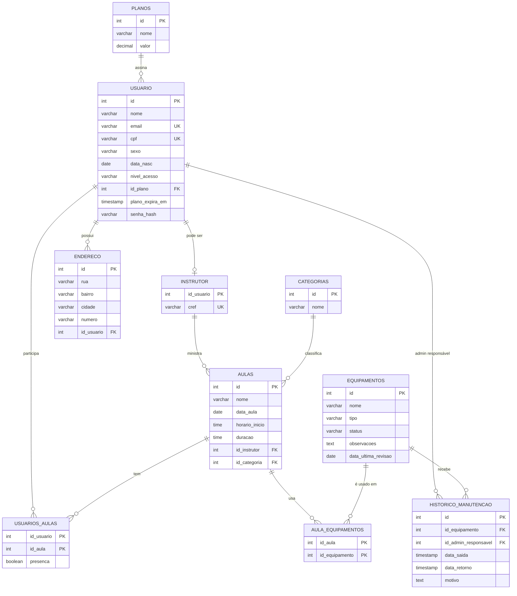

<div align="center">

# 🏋️ X Academia

**Sistema de gerenciamento de academia — projeto de estudo**


</div>

---

> [!WARNING]
> ## ⚠️ Aviso importante
> Este é um **projeto inteiramente para fins de estudo e aprendizado**.
> **Nenhum dado presente neste repositório é real.** Nomes, e-mails, CPFs, endereços, CREFs, senhas e demais informações são **fictícios**, gerados apenas para popular o banco de testes. Qualquer semelhança com pessoas reais é mera coincidência.
> **Não utilize este projeto em produção** nem insira dados reais nele.

---

## 📑 Sumário

- [📖 Sobre o projeto](#-sobre-o-projeto)
- [✨ Funcionalidades](#-funcionalidades)
- [🛠️ Tecnologias](#️-tecnologias)
- [🗄️ Banco de dados](#️-banco-de-dados)
- [🔌 Endpoints da API](#-endpoints-da-api)
- [🚀 Como executar](#-como-executar)
- [🔐 Credenciais de teste](#-credenciais-de-teste)
- [📚 Objetivo de aprendizado](#-objetivo-de-aprendizado)
- [📄 Licença](#-licença)

---

## 📖 Sobre o projeto

O **X Academia** é um sistema para gerenciar o dia a dia de uma academia: cadastro de usuários com diferentes níveis de acesso, planos com controle de renovação, aulas por categoria, instrutores e o controle dos equipamentos, incluindo o histórico de manutenção.

O projeto foi criado para praticar **modelagem de dados, SQL e desenvolvimento de API**, partindo de um diagrama relacional.

---

## ✨ Funcionalidades

| Módulo | Descrição |
|---|---|
| 👤 **Usuários** | Cadastro com níveis de acesso: `admin`, `instrutor` e `aluno` |
| 💳 **Planos** | Planos com valor e data exata de expiração para controle de renovação |
| 🧑‍🏫 **Instrutores** | Vínculo com usuário e registro de CREF único |
| 🏠 **Endereços** | Endereço associado a cada usuário |
| 🗓️ **Aulas** | Aulas com data, horário, duração, instrutor e categoria |
| 🏷️ **Categorias** | Modalidades como Boxe, Crossfit, Musculação, Yoga e Spinning |
| ✅ **Presença** | Matrícula dos alunos nas aulas com controle de presença |
| 🏗️ **Equipamentos** | Controle de status: `disponivel`, `manutencao` ou `descartado` |
| 🔧 **Manutenção** | Histórico com admin responsável, data de saída/retorno e motivo |

---

## 🛠️ Tecnologias

<!-- Ajuste esta tabela conforme o stack real do repositório -->

| Camada | Tecnologia |
|---|---|
| Banco de dados | PostgreSQL |
| Extensões | `pgcrypto` (hash de senhas de teste) |
| Back-end | _preencher_ |
| Front-end | _preencher_ |

---

## 🗄️ Banco de dados

O script completo está em [`academia.sql`](./academia.sql) e contém:

- 🧱 **DDL** com as 10 tabelas, chaves primárias, estrangeiras e `CHECK` de valores permitidos;
- 🧪 **Dados fictícios** em todas as tabelas;
- 🔢 Ajuste das *sequences* após os inserts com id explícito.

### Diagrama entidade-relacionamento



### Resumo das tabelas

| Tabela | Função |
|---|---|
| `usuario` | Dados pessoais, nível de acesso, plano e expiração |
| `instrutor` | Extensão do usuário com o CREF |
| `endereco` | Endereços dos usuários |
| `planos` | Planos disponíveis e seus valores |
| `categorias` | Modalidades das aulas |
| `equipamentos` | Inventário e status de cada equipamento |
| `historico_manutencao` | Registro de saídas e retornos para manutenção |
| `aulas` | Aulas agendadas |
| `aula_equipamentos` | Relação N:N entre aulas e equipamentos |
| `usuarios_aulas` | Relação N:N entre alunos e aulas, com presença |

> [!NOTE]
> O diagrama não impede, por si só, que um aluno seja admin responsável por uma manutenção ou que uma aula seja atribuída a quem não é instrutor. Essas regras devem ser validadas na aplicação (ou via *trigger*).

---

## 🔌 Endpoints da API

> [!IMPORTANT]
> Esta seção é um **modelo**. Substitua as linhas de exemplo pelos endpoints reais do projeto, mantendo o formato da tabela.

### Formato sugerido

| Método | Rota | Descrição | Acesso |
|:---:|---|---|:---:|
| `GET` | `/exemplo` | Lista os registros | 🔓 / 🔒 |
| `GET` | `/exemplo/{id}` | Busca um registro pelo id | 🔓 / 🔒 |
| `POST` | `/exemplo` | Cria um registro | 🔒 |
| `PUT` | `/exemplo/{id}` | Atualiza um registro | 🔒 |
| `DELETE` | `/exemplo/{id}` | Remove um registro | 🔒 |

**Legenda:** 🔓 público · 🔒 requer autenticação

### Grupos de endpoints

<!-- Copie o bloco abaixo para cada grupo (usuários, planos, aulas, equipamentos, etc.) -->

<details>
<summary><strong>👤 Usuários</strong></summary>

| Método | Rota | Descrição | Acesso |
|:---:|---|---|:---:|
| — | _preencher_ | _preencher_ | — |

</details>

<details>
<summary><strong>🗓️ Aulas</strong></summary>

| Método | Rota | Descrição | Acesso |
|:---:|---|---|:---:|
| — | _preencher_ | _preencher_ | — |

</details>

<details>
<summary><strong>🏗️ Equipamentos e manutenção</strong></summary>

| Método | Rota | Descrição | Acesso |
|:---:|---|---|:---:|
| — | _preencher_ | _preencher_ | — |

</details>

---

## 🚀 Como executar

### 1. Clonar o repositório

```bash
git clone https://github.com/PedroAugcardozo/X_Academia.git
cd X_Academia
```

### 2. Criar o banco de dados

```bash
createdb academia
psql -d academia -f academia.sql
```

> [!CAUTION]
> O script começa com `DROP TABLE IF EXISTS`. Execute **apenas em ambiente de desenvolvimento**, nunca em um banco que contenha dados que você queira manter.

### 3. Executar a aplicação

_Descreva aqui os comandos para subir a API/aplicação (variáveis de ambiente, porta, etc.)._

---

## 🔐 Credenciais de teste

Todas as credenciais abaixo são **fictícias**, criadas apenas para testes locais.

| Perfil | E-mail | Senha |
|---|---|---|
| 🛡️ Admin | `carlos.menezes@academia.com` | `admin123` |
| 🛡️ Admin | `fernanda.albuquerque@academia.com` | `admin123` |
| 🛡️ Admin | `ricardo.tavares@academia.com` | `admin123` |
| 🧑‍🏫 Instrutor | `juliana.prado@academia.com` | `123456` |
| 🧑‍🏫 Instrutor | `marcos.rocha@academia.com` | `123456` |
| 🧑‍🏫 Instrutor | `patricia.souza@academia.com` | `123456` |
| 🏃 Aluno | `ana.lima@email.com` | `123456` |
| 🏃 Aluno | `bruno.costa@email.com` | `123456` |

As senhas são armazenadas com hash **BCrypt** (gerado pelo `pgcrypto`). Os demais alunos seguem o mesmo padrão de senha.

---

## 📚 Objetivo de aprendizado

- Modelar um banco relacional a partir de um diagrama (DBML);
- Aplicar relacionamentos 1:1, 1:N e N:N com chaves compostas;
- Usar `CHECK`, `UNIQUE` e `DEFAULT` para garantir integridade dos dados;
- Armazenar senhas com hash em vez de texto puro;
- Popular o banco com dados fictícios para testes.

---

## 📄 Licença

Projeto de estudo, sem fins comerciais. Fique à vontade para usar como referência de aprendizado.

<div align="center">

Feito com 💪 por [Pedro Augusto Cardozo](https://github.com/PedroAugcardozo) para estudo.

</div>
